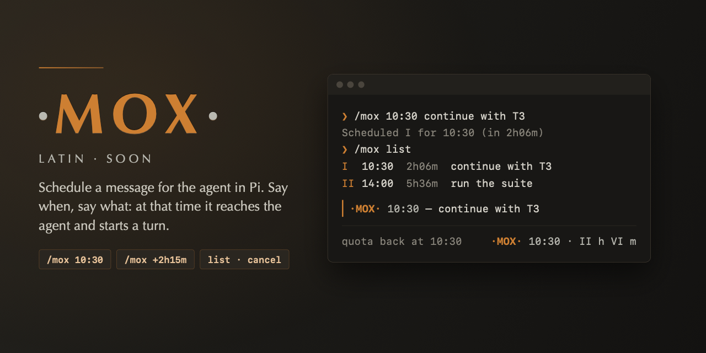

# ·MOX· pi-mox



Schedule a message for the agent in [Pi](https://github.com/earendil-works/pi). Say when, say what, and at
that time the message reaches the agent and starts a turn. *Mox* is Latin for "soon".

Typical use: the session's quota runs out and says it refreshes at 10:30, but it is 8:24. Schedule the
next step once and walk away:

```
/mox 10:30 continúa con T3
```

## Install

```
pi install npm:pi-mox
```

## Usage

| Command | What it does |
| --- | --- |
| `/mox <time> <message>` | Deliver `<message>` to the agent at `<time>` |
| `/mox list` (or `/mox`) | Show the pending cues, each message on one line cut at 60 characters with `…` |
| `/mox show <id>` | Show one cue with its whole message |
| `/mox cancel <id>` | Cancel a cue; the id is Roman (`II`, `ii`) or Arabic (`2`) |

`list`, `show` and `cancel` are reserved first words.

### Time

- Absolute: `10:30` or `9:05`, 24-hour (`0:00`–`23:59`). Today at that time; if it is equal to or before now,
  tomorrow. `24:00`, `10:60` and `1030` are rejected.
- Relative: `+` followed by `<n>h`, `<n>m`, `<n>s` in that order: `+2h15m`, `+90m`, `+45s`, `+1h30s`.
  The total must be above zero.

The message is the rest of the line, trimmed and delivered verbatim.

### Examples

```
/mox 10:30 continúa con T3
Scheduled I for 10:30 (in 2h06m): continúa con T3

/mox +5h36m corre la suite
Scheduled II for 14:00 (in 5h36m): corre la suite

/mox list
I   10:30  2h06m  continúa con T3
II  14:00  5h36m  corre la suite

/mox show I
I  10:30  2h06m
continúa con T3

/mox cancel II
Cancelled II (14:00): corre la suite
```

The footer shows the next cue, with the time left in Roman numerals (hours omitted at zero, minutes rounded
up, under a minute shows `I m`), and `(+N)` when more cues wait:

```
·MOX· 10:30 · II h VI m (+1)
```

When a cue is due, the agent receives the message and the conversation shows:

```
·MOX· 10:30 — continúa con T3
```

Errors (bad time, missing message, unknown id) are shown with a usage line and change nothing.

## Behavior

- **Delivery.** The message is sent as a follow-up that triggers a turn: when Pi is idle a turn starts at
  once; when Pi is busy the message waits for the current run to finish.
- **One shot.** A cue fires once and is removed. If delivery fails the error is shown like any other error;
  there is no retry.
- **In memory.** Cues are kept only while Pi runs. Closing Pi (or ending the session) drops them.
- **Wall clock.** The next cue is checked against the clock at least every 30 seconds, so a cue that came due
  while the computer was suspended is delivered as soon as it resumes. Timers never keep Pi from exiting.
- **Ids.** Roman numerals counting up from `I` in each session; an id is never reused, even after a cue is
  cancelled or fired.

## Development

Requires Node.js 22.18 or newer (the sources are TypeScript run with type stripping; there is no build).

```
npm test
```

- `src/mox.ts`: core with no Pi runtime imports: time parsing, Roman numerals, the cue list and scheduler
  (injectable clock and timers), the command runner.
- `src/wire.ts`: connects the core to Pi's extension API.
- `extensions/mox.ts`: the package's Pi extension entry.

## Releasing

Branches: work goes to `develop` through pull requests; `main` receives `develop` when a release closes.

1. On a `release/X.Y.Z` branch from `develop`: set `version` in `package.json`, rename `## Unreleased` in `CHANGELOG.md` to `## X.Y.Z`, and commit `release X.Y.Z: <summary>`. Merge it into `develop`, then `develop` into `main`.
2. Tag `main` with `vX.Y.Z` and push the tag.
3. The [release workflow](.github/workflows/release.yml) checks the tag against `package.json` and `CHANGELOG.md`, runs the tests, and stages the version on npm through trusted publishing, with provenance. Approve it with 2FA: `npm stage list`, then `npm stage approve <id>`, or on npmjs.com. It then creates the GitHub release with the version's CHANGELOG section as notes.

## License

MIT
